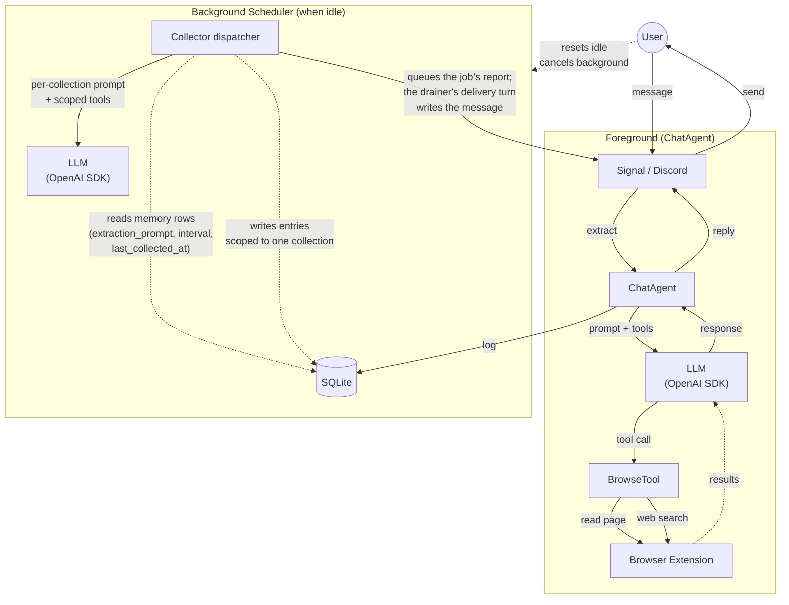

# CLAUDE.md — Penny Chat Agent

## Architecture Overview



- **Channels**: Signal (WebSocket + REST) or Discord (discord.py bot)
- **Ollama**: Local LLM inference (default model: gpt-oss:20b)
- **Vision**: Image attachments ride the chat turn's own user message for the chat model to read directly (#2635) — no separate caption call or vision model
- **Image Generation**: Optional image model (e.g., x/z-image-turbo) for generating images via the `generate_image` chat tool (config-gated on `LLM_IMAGE_MODEL`)
- **Embedding Model**: Required dedicated embedding model (e.g., embeddinggemma) for memory dedup and similarity recall — a hard prerequisite (startup fails fast if `LLM_EMBEDDING_MODEL` is unset), so memory never runs in a degraded, embedding-less mode
- **Browser Extension**: Web search and page reading — all web access goes through the connected browser
- **SQLite**: Logs all prompts and messages; stores the memory framework (collections, logs) and conversation history

## Where to read before you change code

Before changing code under one of these paths, read its reference doc in full.

| Area | Paths | Read first |
|---|---|---|
| Agents and the agent loop | `penny/agents/`, `penny/preflight.py` | `docs/reference/agents.md` |
| Tools and micro-contexts | `penny/tools/` | `docs/reference/tools.md` |
| The database and memory layer | `penny/database/`, `penny/clock.py` | `docs/reference/database.md` |
| Channels | `penny/channels/` | `docs/reference/channels.md` |
| The scheduler and collector | `penny/scheduler/`, `penny/agents/collector.py`, `penny/notification.py` | `docs/reference/scheduler-and-collector.md` |
| Validation and text validity | `penny/validation/`, `penny/text_validity.py` | `docs/reference/validation.md` |
| The eval harness and its reporting | `penny/tests/eval/` | `docs/reference/eval-harness.md` |
| Commands | `penny/commands/` | covered in this file — see "Command System" |
| The shared LLM client | `penny/llm/` | covered in this file — see the Directory Structure's `llm/` entries |
| Email clients | `penny/email/` | covered in this file — see the Directory Structure's `email/` entries |
| Plugins | `penny/plugins/` | covered in this file — see "Plugin System" |

## Directory Structure

```
penny/
  penny.py            — Entry point. Penny class: creates agents, channel, scheduler
  config.py           — Config dataclass loaded from .env, channel auto-detection
  clock.py            — `Clock`: the one place the runtime asks what time it is (#2207) — production's real clock, the eval harness's pinned one
  config_params.py    — ConfigParam + RuntimeParams: runtime-configurable settings with 3-tier lookup
  constants.py        — Enums (SearchTrigger), reaction emojis, browse constants
  prompts.py          — LLM prompt templates (chat conversation, email-summarize).  Collector prompts live on memory rows (extraction_prompt) instead
  responses.py        — All user-facing response strings (PennyResponse class)
  startup.py          — Startup announcement message generation (git commit info)
  preflight.py        — Setup-health preflight checks: one legible startup summary; hard-fails on an unreachable LLM/embedding model, soft-warns on image/browser/channel issues
  datetime_utils.py   — Timezone derivation from location (geopy + timezonefinder)
  notification.py     — The finished cycle's report hand-off (#1911, reshaped #2656): the report row the cycle enqueues, the typed JobReport + its deterministic render, the outcome vocabulary the run record is stamped from, and the send gate
  agents/
    base.py           — Agent base class: agentic loop, tool execution, Ollama integration
    models.py         — ControllerResponse, MessageRole, ToolCallRecord, GeneratedQuery, plus the run-abort trio (#1909)
    chat.py           — ChatAgent: conversation-mode agent — full tool surface, the ambient self-state prompt, one static instruction (there is no conversation machine), the config/writes record delivered onto the configuring/writing tool's own result; `handle_job_report` is the system-originated delivery turn a notifying job's report rides (#2656)
    self_state.py     — `SelfStateHeader`: renders Penny's operational self-state into the chat prompt's dynamic tail
    collector.py      — Collector: single dispatcher agent driving every per-collection extractor
  scheduler/
    base.py           — BackgroundScheduler + Schedule ABC
    schedules.py      — PeriodicSchedule implementation
    send_queue_drainer.py — `SendQueueDrainer`: delivers queued autonomous messages on the send cooldown, by origin lane (#1939); composes a notifying cycle's report on one chat-agent delivery turn before delivering it (#2656)
  commands/
    __init__.py       — create_command_registry() factory
    base.py           — Command ABC, CommandRegistry
    models.py         — CommandContext, CommandResult, CommandError
    config.py         — /config: view and modify runtime settings
    index.py          — /commands: list available commands
    profile.py        — /profile: user info collection (name, location, DOB, timezone)
  tools/
    base.py           — Tool ABC (`args_model` + `run()`) + ToolRegistry/ToolExecutor — arg validation, did-you-mean on a missing tool
    models.py         — ToolCall, ToolResult (uniform structured tool return: message/success/mutated/source_urls/narration), ToolDefinition, and per-tool arg models
    browse.py         — BrowseTool: web search and page reading via the browser extension, with optional micro-context extraction (#1588)
    micro_context.py  — MicroContext: single-shot extraction over bulk content (the browse extractor — its one customer since the notify composer retired, #2656)
    generate_image.py — GenerateImageTool: image generation via OllamaImageClient; stored to media, delivered deterministically by id to its own reply (ToolResult.media_id → ControllerResponse.generated_media_ids → send_response) (chat-only, gated on LLM_IMAGE_MODEL)
    content_cleaning.py — Post-processing for browse results (strips navigation, proxy images, boilerplate)
    search_emails.py  — SearchEmailsTool (JMAP + Zoho) — chat surface, config-gated on a mailbox
    read_emails.py    — ReadEmailsTool (JMAP + Zoho) — summarizes fetched bodies against the current message
    list_emails.py    — ListEmailsTool (folder listings; Zoho only)
    list_folders.py   — ListFoldersTool (available mailboxes; Zoho only)
    draft_email.py    — DraftEmailTool (compose + stage draft; Zoho only). All five retired the /email + /zoho commands (epic #1445) — built per turn by ChatAgent's email_tools_builder; NL-dispatch contract: tests/eval/chat/idle/test_email_dispatch.py
    notifications.py  — NotificationsMuteTool / NotificationsUnmuteTool: chat-surface tools over the MuteState row (`db.users`); retired /mute + /unmute
    collection_instantiation.py — The pure pieces behind `collection_configure`: schedule/expiry parsing and renders — no parameters to bind, no rendering seam (#1591)
    memory_args.py    — Pydantic arg models for the memory tool surface
    memory_tools.py   — Memory tool subclasses dispatching through `db.memory(name)`; `find`/`run_list`/`run_get`, `collection_configure`
  channels/
    __init__.py       — create_channel() factory, channel type constants
    base.py           — MessageChannel ABC, IncomingMessage, shared message handling
    signal/
      channel.py      — SignalChannel: httpx for REST, websockets for receive
      models.py       — Signal WebSocket envelope Pydantic models
    discord/
      channel.py      — DiscordChannel: discord.py bot integration
      models.py       — DiscordMessage, DiscordUser Pydantic models
    browser/
      channel.py      — BrowserChannel: the addon's WebSocket server and the transport every browse/tool request rides
      models.py       — Browser WebSocket protocol Pydantic models
  database/
    database.py       — Database facade: thin wrapper creating domain stores
    knowledge_store.py — KnowledgeStore: summarized web page content for factual recall
    email_rule_store.py — EmailRuleStore (`db.email_rules`): create / list-active / mark-applied for the `email_rule` table (plugin email backends). Deals only in the row's serialized JSON — the typed condition/action models live in the owning plugin, so the DB layer imports no plugin
    message_store.py  — MessageStore: log_message, log_prompt, log_command, threads
    send_queue_store.py — SendQueueStore: durable outbound queue — enqueue, `next_pending` (by origin lane), mark_sent (#1939)
    user_store.py     — UserStore: get_info, save_info, mute/unmute
    memory/           — The memory layer: `Memory`/`Collection`/`Log`, `MemoryStore`, the message-log/run-log facades, the undo journal
    mutation_store.py — `MutationStore`: the registry-mutation event ledger, with before/after field priors (#1946)
    cursor_store.py   — CursorStore: per-agent read cursors into log-shaped memories
    media_store.py    — MediaStore: browsed images, matched to outgoing text by embedding at egress (generated images deliver by id to their own reply, then join this pool)
    models.py         — SQLModel tables (see Data Model section)
    migrate.py        — Migration runner: file discovery, tracking table, validation
    migrations/       — Numbered migration files (0001–0122)
  llm/
    client.py         — LlmClient: OpenAI SDK wrapper (chat + embed + list_models via /v1/models) for any OpenAI-compatible backend (Ollama, omlx, etc.). list_models translates SDK errors into the LlmError hierarchy so the preflight can tell an unreachable endpoint from an unverifiable one. `chat` takes a required `call_link: CallLink` and reads `run_id`/`parent_run_id`/`parent_tool_call_id` straight off it — no ambient state, no default
    call_link.py      — `CallLink` (#2458): the frozen, explicit run/tool-call linkage every model call and every dispatched tool call carries — `run_id`/`parent_run_id`/`parent_tool_call_id` (logged identity) plus `tool_call_id` (position: the tool call this link is presently inside, consumed only by `child()`). Constructors: `top(run_id)` / `new_top()` for a run starter, `for_tool_call(id)` for the dispatcher, `child()` for a micro-context's own draw — required everywhere, no ambient reads, no fallback
    image_client.py   — OllamaImageClient: Ollama-specific HTTP client for image generation and model listing
    models.py         — LlmMessage, LlmResponse, LlmToolCall, LlmError hierarchy (SDK-decoupled Pydantic types)
    embeddings.py     — Re-exports serialize/deserialize/cosine from shared similarity/ package
    similarity.py     — Penny-specific: embed_text (safe single-text embedding helper)
  email/
    models.py         — Provider-agnostic email models: EmailAddress, EmailSummary, EmailDetail (shared by the JMAP + Zoho clients, the EmailClient protocol, and the zoho plugin)
    protocol.py       — EmailClient Protocol — shared interface for JMAP + Zoho email backends
  plugins/            — Plugin system (opt-in integrations, loaded at startup from the PLUGINS env list; see "Plugin System" below)
    __init__.py       — Plugin base (is_configured/get_tools/close) + load_plugins(config)
    fastmail/         — Fastmail JMAP client relocated into plugins/ (client.py: JmapClient; models.py: JmapSession). A plain package, NOT a Plugin subclass — email stays auto-gated on FASTMAIL_API_TOKEN via Penny._init_email, not the PLUGINS list
    zoho/             — ZohoPlugin: Zoho Mail client relocated into the plugin (mail_client.py: ZohoClient; mail_models.py: ZohoCredentials/ZohoAccount/ZohoFolder/ZohoSession) — the mail client stays auto-gated on the ZOHO OAuth triple via Penny._init_email, not the PLUGINS list — plus Mail organisation + Calendar + Projects tools (email_tools/calendar_tools/project_tools + their clients; email-rule persistence in rules.py)
    invoiceninja/     — InvoiceNinjaPlugin: invoice + expense tools (tools.py + client.py + models.py)
  validation/         — Model-I/O validation: the one behaviour taxonomy + the live disposition machinery
    conditions.py     — The behaviour taxonomy (keystone): ConditionKey + BehaviorCondition + CATALOG; one catalog of every condition we classify Penny's behaviour through (supersedes ValidationReason + RunHealthFlag). Dependency-light leaf
    outcomes.py       — ValidationOutcome disposition union (Proceed/Retry/Repair/RejectToolCall/NudgeContinue/Stop), ResponseValidator protocol, LoopContext, run_validators
    response_validators.py — Concrete response validators: xml/refusal/hallucinated-URL; `run_shape_validators` is empty on every agent shape — there is no narrate-from-the-record or premature-done guard left to compose
  html_utils.py       — Shared HTML text extraction helpers
  text_validity.py    — Content-validity predicates: degeneracy, half-formed sends, did-you-mean, empty-draw — shared by the loop and the tools
  tests/
    conftest.py       — Pytest fixtures for mocks and test config
    test_embeddings.py, test_similarity.py, test_periodic_schedule.py, test_scheduler.py
    mocks/
      signal_server.py  — Mock Signal WebSocket + REST server (aiohttp)
      llm_patches.py    — MockLlmClient: patches openai.AsyncOpenAI for chat + embed
    agents/           — Per-agent integration tests
      test_chat_agent.py, test_collector.py, test_agentic_loop.py,
      test_context.py
    channels/         — Channel integration tests
      test_signal_channel.py, test_signal_reactions.py, test_signal_vision.py,
      test_signal_formatting.py, test_startup_announcement.py
    commands/         — Per-command tests
      test_commands.py, test_config.py, test_debug.py,
      test_system.py, test_test_mode.py
    database/         — Migration validation tests
      test_migrations.py
    fastmail/         — Fastmail JMAP client tests
      test_client.py
    tools/            — Tool tests
      test_tool_timeout.py, test_tool_not_found.py, test_tool_reasoning.py,
      test_notifications.py, test_email_tools.py
Dockerfile            — Python 3.14-slim
pyproject.toml        — Dependencies and project metadata
```

## Agent Architecture

Two agent shapes sit on one base loop. **ChatAgent** (`penny/agents/chat.py`) handles a user turn with the full tool surface and the ambient self-state prompt; **Collector** (`penny/agents/collector.py`) is the single dispatcher for every background extraction, scoped to one collection's tools per cycle. Both run atop the base agentic loop (`penny/agents/base.py`): call the model, execute tool calls, validate the response.

Read `docs/reference/agents.md` before changing the base loop, ChatAgent, or self-state rendering; read `docs/reference/scheduler-and-collector.md` before changing the Collector or the scheduler.

## Scheduler System

`BackgroundScheduler` runs the send-queue drainer and the collector dispatcher in priority order while the system is idle; each schedule type (periodic, cadence-driven via a collection's own RRULE) decides when its task is next due. Read `docs/reference/scheduler-and-collector.md` before changing scheduling or collector cadence.

## Channel System

Signal, Discord and the browser extension share the `MessageChannel` ABC — `extract_message()` in, `send_response()`/`send_message()` out, both funnelling through one logging chokepoint (`_log_and_send()` → `_send_raw()`) so nothing Penny sends bypasses the conversation record. Read `docs/reference/channels.md` before changing a channel or the outgoing-send path.

## Command System

Penny supports slash commands sent as messages (e.g., `/config`, `/profile`). Commands are handled before the message reaches the agent loop.

### Architecture (`commands/`)
- **Command ABC** (`base.py`): Each command implements `name`, `description`, `aliases`, and `async execute(context) → CommandResult`
- **CommandRegistry** (`base.py`): Maps command names/aliases to handlers, dispatches messages starting with `/`
- **Factory** (`__init__.py`): `create_command_registry()` registers all built-in commands

### Built-in Commands (always registered)
- **/commands** (`index.py`): Lists all available commands with descriptions
- **/config** (`config.py`): View and modify runtime settings (e.g., `/config idle_seconds 600`). Reads/writes RuntimeConfig table in SQLite; changes take effect immediately
- **/profile** (`profile.py`): View or update user profile (name, location, DOB). Derives IANA timezone from location. Required before Penny will chat

Preferences are no longer slash commands — like/dislike add, remove-by-meaning, and list are dispatched from natural language onto the `likes` / `dislikes` memory collections (see the ChatAgent section). The retired `/like` + `/unlike` + `/dislike` + `/undislike` commands wrote the legacy `preference` table (dropped by migration 0097); the collections are what recall + the ambient extractor share.

There are no conditional (config-gated) commands — email retired onto the chat tool surface (see the ChatAgent email-tools bullet above); `/bug`, `/feature`, `/draw`, `/mute`, `/unmute`, `/schedule`, `/unschedule` all retired earlier in epic #1445.

### Runtime Configuration
- `/config` reads and writes to a `RuntimeConfig` table in SQLite
- `ConfigParam` definitions in `config_params.py` declare runtime-configurable settings with types and validation
- `RuntimeParams` class provides attribute access: `config.runtime.IDLE_SECONDS`
- Three-tier lookup chain: DB override → env override → ConfigParam.default
- Config values are read on each use (not cached), so changes take effect immediately
- Groups: Chat (max steps, search URL, context limits, domain permission mode), Background (idle threshold, COLLECTOR_TICK_INTERVAL, COLLECTOR_RUN_HISTORY, BACKGROUND_MAX_STEPS, dedup thresholds), Email (body max length, search/list limits, request timeout), Browse (parallel fetch cap `MAX_QUERIES`, per-call total query ceiling `BROWSE_MAX_QUERIES_PER_CALL`), Token budgets (one `TOKEN_BUDGET_*` param per model-call kind — chat, collector, browse-extract — read by `token_budget_for(runtime, agent_name)` and sent as `LlmClient.chat()`'s `token_budget`, #2474)

## Data Model

All tables are SQLModel classes in `database/models.py` — the prompt/message logs, the memory/entry/mutation tables, the send queue, media, and per-reader cursors. Read `docs/reference/database.md` before changing a table or a store's read/write shape.

## Message Flow

1. Channel receives message → `extract_message()` → `IncomingMessage`
2. Channel calls `handle_message()`:
   - Checks for slash commands first (dispatches via `CommandRegistry`)
   - Notifies scheduler (resets idle timers, suspends background tasks)
   - Starts typing indicator loop
   - Calls `ChatAgent.handle()` which:
     - Finds parent message if quote-reply (via `external_id` lookup)
     - Walks thread history for context
     - Runs agentic loop with tools
   - Logs incoming message to DB
   - Sends response via `send_response()` (logs + sends); every other outgoing message (commands, status, prompts) goes through `send_message()`, which logs too — all sends funnel through `_log_and_send()` → `_send_raw()`
   - Stops typing indicator, resumes background tasks

## Thread/Context System

- Quote-replying continues a conversation thread
- `MessageLog.parent_id` creates a chain of messages
- `db.messages.get_thread_history()` walks the chain (up to 20 messages); the thread a quote-reply shows is selected by the parent id the channel resolved from the quote's own anchor

## Key Design Decisions

- **Browser-based search**: All web access (search, page reading) goes through the browser extension via BrowseTool. Text queries are converted to search URLs (configurable via `SEARCH_URL`). No third-party search APIs
- **Browse micro-contexts (#1588 — bulk content never enters the main run context)** — moved to `docs/reference/tools.md`.
- **URL fallback**: If the model's final response doesn't contain any URL, the agent appends the first source URL
- **Duplicate tool blocking** — moved to `docs/reference/agents.md`.
- **Tool-result framing (tagged first-person narration)** — moved to `docs/reference/agents.md`.
- **Tool argument validation (Django-form pattern)** — moved to `docs/reference/tools.md`.
- **Model-I/O validation (one behaviour taxonomy)** — moved to `docs/reference/validation.md`.
- **Actionable tool failures** — moved to `docs/reference/tools.md`.
  - **Every miss suggests its nearest match — did-you-mean on lookup/write (#1674)** — moved to `docs/reference/tools.md`.
- **One job, one collection — identity dispatch on `collection_configure` (#1567/#1775)** — moved to `docs/reference/database.md`.
- **Write-gate STOP semantics (control flow lives in the tool)** — moved to `docs/reference/tools.md`.
- **An aborted run names its terminal cause (#1909)** — moved to `docs/reference/agents.md`.
- **Emission provenance (#1568)** — moved to `docs/reference/scheduler-and-collector.md`.
- **Queued sends, not dropped** — moved to `docs/reference/scheduler-and-collector.md`.
- **Invalid draws are rejected, not recovered (#1839)** — moved to `docs/reference/validation.md`.
- **A coherent but WRONG tool call still gets an error tool response** — moved to `docs/reference/validation.md`.
- **Degeneracy guard (discard-and-reroll)** — moved to `docs/reference/validation.md`.
- **Leaked Harmony-envelope guard (discard-and-reroll)** — moved to `docs/reference/validation.md`.
- **Two agent shapes**: ChatAgent (turn-driven, user-facing, full lifecycle + read tools) and Collector (single dispatcher across all collections, scoped read + entry-mutation surface — no lifecycle tools, #1556).  These are the only two run entry points: a chat turn and a collector cycle
- **Priority scheduling**: SendQueueDrainer → Collector dispatcher (Collector returns False when no collection is ready, so the scheduler skips it)
- **Global idle threshold**: Single configurable idle time (default: 60s) controls when idle-dependent tasks become eligible
- **Background cancellation**: Foreground message processing cancels active background tasks (`task.cancel()`) to free the LLM immediately; cancelled work is idempotent and retried next cycle
- **Commands don't interrupt background**: Slash commands run cooperatively without cancelling the active background task
- **Images in the chat turn**: An image attachment rides the current turn's own user message as a data URI with the attachment's real mime type (#2635) — the chat model reads it directly, under chat's token budget and thinking-off last draw. There is no separate caption call and no `LLM_VISION_MODEL` (a non-vision chat model fails the turn honestly through the model-error path). The conversation record keeps a deterministic marker where the image was; history never resends the image
- **Image side-channel** — moved to `docs/reference/agents.md`.
- **Channel abstraction**: Signal and Discord share the same interface; easy to add more platforms
- **Async throughout**: asyncio, httpx.AsyncClient, openai.AsyncOpenAI, discord.py
- **Host networking**: Docker container uses --network host for simplicity (all services on localhost)
- **Pydantic everywhere**: All external data validated with Pydantic models
- **Table-to-bullets**: Markdown tables converted to bullet points in Python (saves model tokens vs. prompting "no tables")
- **Normal casing**: All user-facing strings (status messages, error messages, acknowledgments) use standard sentence casing — not all lowercase
- **Memory framework (Stages 1–5, 9, 10)** — moved to `docs/reference/database.md`.

## Dependencies

- `websockets`, `httpx`, `python-dotenv`, `pydantic`, `sqlmodel`, `openai`, `discord.py`, `psutil`, `dateparser`, `timezonefinder`, `geopy`, `pytz`, `PyJWT`, `python-dateutil` (RRULE parsing + next-fire computation, #1857 — an EXPLICIT dependency, though `dateparser` also pulls it in transitively; `croniter` retired with the cron trigger form)
- Dev: `ruff` (lint/format), `ty` (type check), `pytest`, `pytest-asyncio`, `aiohttp` (mock Signal server)
- Python 3.14+

## Database Migrations

File-based migration system in `database/migrations/` (currently 0001–0122):
- Each migration is a numbered Python file (e.g., `0001_initial_schema.py`) with a `def up(conn)` function
- Two types: **schema** (DDL — ALTER TABLE, CREATE INDEX) and **data** (DML — UPDATE, backfills), both use `up()`
- Runner in `database/migrate.py` discovers files, tracks applied migrations in `_migrations` table
- Runs on startup before `create_tables()` in `penny.py`
- `make migrate-test`: copies production DB, applies migrations to copy, reports success/failure
- `make migrate-validate`: checks for duplicate migration number prefixes (also runs in `make check`)
- Rebase-only policy: if two PRs create the same migration number, the second must rebase and renumber
- Run standalone: `python -m penny.database.migrate [--test] [--validate] [db_path]`

Migration-by-migration history (every numbered migration, why it shipped): `docs/migration-log.md`.

## Plugin System

`penny/penny/plugins/` holds opt-in, third-party integrations that contribute LLM-callable tools to the chat surface. A plugin is a subclass of `Plugin` (`plugins/__init__.py`) exposing `is_configured(config)`, `get_tools()`, and `close()`, with a module-level `PLUGIN_CLASS` pointing at it. `load_plugins(config)` imports each name in the `PLUGINS` env list, skips any that aren't configured (missing credentials → logged, non-fatal), instantiates the rest, and `Penny._init_plugins` collects their tools into `ChatAgent(plugin_tools=…)`. Plugins are long-lived (built at startup, `close()`d in `Penny.shutdown`).

- **zoho** (`plugins/zoho/`): Mail organisation (move/label/folder + `create_email_rule`/`list_email_rules`), Calendar (`calendar_client.py` + `calendar_tools.py`), and Projects (`projects_client.py` + `project_tools.py`) tools over the Zoho REST APIs. Reuses the `ZOHO_API_ID`/`ZOHO_API_SECRET`/`ZOHO_REFRESH_TOKEN` triple. Datetime tools convert to UTC before formatting (`astimezone(UTC)`).
- **invoiceninja** (`plugins/invoiceninja/`): invoice + expense tools over the InvoiceNinja v5 API (`INVOICENINJA_API_TOKEN` + `INVOICENINJA_URL`).

**Email-rule data layer** (#1737): email rules are persisted to the `email_rule` table via the `db.email_rules` domain store (`EmailRuleStore` — create / list-active / mark-applied), not raw `session.exec(select(...))`. Condition/action are **typed** (`EmailRuleCondition` / `EmailRuleAction` in `plugins/zoho/rule_models.py` — optional `from`/`subject_contains`/`body_contains` and `move_to`/`label`, each `extra="forbid"` + at-least-one-field), so `create_email_rule` rejects an unknown or empty shape at the tool boundary with an actionable, field-naming message rather than absorbing an arbitrary dict; the row stores their serialized JSON. `EmailRule.user_id` was dropped (single-user Penny — migration 0099); the `provider` column stays (`PennyConstants.PROVIDER_ZOHO`, a future non-Zoho backend gets its own tag). **Known gaps** (tracked as follow-ups): the rules are persisted but **not yet applied automatically** — `plugins/zoho/rules.py` (`RuleMatcher`/`RuleExecutor`/`apply_email_rules`) is the intended application engine but isn't wired into any scheduler, and the model-facing tool surface has no `tests/eval/` contract yet.

## Extending

- **New tool**: Subclass `Tool` in tools/, implement `name`, `description`, `parameters`, `async execute()`, add to agent's tool list in penny.py
- **New channel**: Implement `MessageChannel` ABC, create models, add to `create_channel()` factory
- **New agent type**: Subclass `Agent`, implement `execute()` for background tasks or custom `handle()` for message processing
- **New command**: Subclass `Command` in commands/, implement `name`, `description`, `execute()`, register in `create_command_registry()`
- **New schedule type**: Subclass `Schedule`, implement `should_run()`, `reset()`, `mark_complete()`
- **New LLM backend**: Any OpenAI-compatible endpoint works via `LlmClient` — just set `base_url` / `api_key`. Non-OpenAI-compatible backends can implement the `LlmClient` interface directly (`async chat()`, `async embed()`)

## Test Infrastructure

Strongly prefer end-to-end integration tests over unit tests. Test through public entry points with mocks for external services. Prefer folding new assertions into existing tests over adding new test functions — only add a new test when no existing test covers the relevant code path.

**Mocks** (in `tests/mocks/`):
- `MockSignalServer`: WebSocket + REST server using aiohttp, captures outgoing messages and typing events
- `MockLlmClient` (`llm_patches.py`): Monkeypatches `openai.AsyncOpenAI` so `LlmClient` returns canned `LlmResponse` objects; configurable via `set_default_flow()` or `set_response_handler()`; tracks `requests` and `embed_requests` for assertions. Which micro-context flavours a custom handler CLAIMS (rather than letting the built-in intercept answer) are keyword arguments on `set_response_handler` — `answers_micro_contexts` (default `True`) and `answers_state_classifier` (default `False`) — plain parameters, not attributes smuggled onto the handler function, so a misspelt flag is a signature error instead of a silently-ignored one

**Fixtures** (in `tests/conftest.py`):
- `TEST_SENDER`: Standard test phone number constant
- `signal_server`: Starts mock Signal server on random port
- `mock_llm`: Patches the OpenAI SDK with configurable responses
- `make_config`: Factory for creating test configs with custom overrides
- `running_penny`: Async context manager for running Penny with cleanup (uses WebSocket detection, not sleep)
- `setup_llm_flow`: Factory to configure mock LLM for message + background task flow
- `wait_until(condition, timeout, interval)`: Polls a condition every 50ms until true or timeout (10s default)
- **`db`: the default database for a test — just add it as an argument.** A ready-to-use `Database` with the real startup schema (`create_tables()` + every migration, the state Penny boots with). No setup, no boilerplate — this is the naive-correct way to get a database in a test.
- **`@pytest.mark.bare_db`** makes that same `db` fixture yield a bare current-models schema with **no** migration-seeded rows — for low-level store tests that declare exactly the memories they need (migration 0026 would otherwise seed system log memories). Put it on a test, a class, or a whole module (`pytestmark = pytest.mark.bare_db`); the tests still just take `db` — see e.g. `tests/tools/test_memory_tools.py`. The fixture and both schemas live in one place (conftest), not duplicated per file.
- `test_db`: a per-test SQLite **path** (string) pre-seeded with the full post-migration schema — used by fixtures/tests that construct their own `Penny`/`Config` and need a db_path, not a `Database`
- `require_memory(db, name)` (a plain function, not a fixture): `db.memory(name)` narrowed to a non-`None` `Memory`. `db.memory` returns `Memory | None`, which a test seeding or reading a memory it just created never wants — this asserts presence, so a typo'd or since-renamed name fails naming the name instead of raising `AttributeError` on `None` frames later. It is also what keeps `unresolved-attribute` an **error** in `pyproject.toml`: with the Optional noise narrowed and SQLModel column expressions on `col()`, the rule's remaining hits are calls to methods that don't exist

**Why they're fast — schema templates** (`tests/schema_template.py`): building a test DB's schema is expensive (`create_tables()` issues the DDL for every table, `migrate()` replays the whole ~100-file migration stack — ~110ms together), and the suite builds hundreds of fresh databases, which was the single largest chunk of `make check`. The schema is deterministic, so the module builds each template **once per process** and the `db` fixture hands out ~1ms file copies (byte-identical to building from scratch, so tests see no behavioural difference). **Don't hand-roll `Database(path)` + `create_tables()` + `migrate()` — take the `db` fixture instead** (with `@pytest.mark.bare_db` if you need the bare schema), so a test writer gets the fast path by default rather than by remembering a rule. The building-block functions `schema_only_db(path)` / `migrated_db(path)` back the fixture and are there for the few helpers that genuinely can't use it — a custom filename, a `runtime=` override, or more than one database in a test. This is what cut `make check`'s test phase from ~52s to ~18s.

**Test Timing** — never use `asyncio.sleep(N)` in tests:
- Use `wait_until(lambda: <condition>)` to poll for expected side effects (DB state, message count, etc.)
- `scheduler_tick_interval` is set to 0.05s in test config (vs 1.0s production) so scheduler-dependent tests complete quickly
- `running_penny` detects WebSocket connection via `signal_server._websockets` instead of sleeping
- For negative assertions (nothing should happen), verify immediately — don't sleep to "make sure"

**Test Flow**:
1. Start mock Signal server (random port)
2. Monkeypatch the OpenAI SDK (via `mock_llm`)
3. Create Penny with test config pointing to Signal mock
4. Push message through mock Signal WebSocket
5. `wait_until` the expected side effect (outgoing message, DB change, etc.)
6. Assert on captured messages, LLM requests, DB state

**Performance**: The non-eval suite runs in ~18s. Two levers: `scheduler_tick_interval` is 0.05s in tests (vs 1.0s prod), and the schema templates (above) build the DB schema once per process and copy it per test instead of re-running `create_tables()` + all migrations each time (which was the single largest chunk of the runtime — ~34s).

### Live-model eval suite (`tests/eval/`)

A separate suite of **contract tests against a real Ollama model** — the canonical
coverage of Penny's core use cases and the yardstick for swapping models. It's
gated behind the `eval` marker (excluded from `make check`/`make pytest`).

**Cases are collected by the BEHAVIOUR they test**: which agent or microcontext is
under test, and which state that agent is in. The tree is that grouping.

```
tests/eval/
  conftest.py       — shared machinery every driver and case calls into. Stays at the ROOT:
                      pytest resolves conftest hierarchically, so one here serves every
                      subdirectory. Does NOT load drivers/ itself — see tests/conftest.py
  drivers/          — one module per DRIVER (chat_eval, collector_cycles_eval, the per-agent
                      ones) — never appended to conftest.py, so two case PRs that each add
                      a driver land in different files (#2395). Loaded as a plugin by
                      `penny/tests/conftest.py` (the suite's actual root), not by this
                      directory's own conftest.py: pytest only honours `pytest_plugins` in
                      an INITIAL conftest — one on the path pytest was invoked with — and
                      `tests/eval/conftest.py` is that only for a run scoped under
                      `tests/eval/`, never for the whole-suite run CI does
  utils/            — shared machinery, and nothing else: artifacts · checkpoint ·
                      cohort · report · assemble · comment_split · roster ·
                      endpoint_smoke · baseline · replay · run_health · assertions ·
                      catalogue (the generated list of every case, by area — including the
                      retired `conversation machine` area and machine edges, kept only for
                      the handful of historical cases that still name one) ·
                      given (what a round was given, split into the content a number is
                      sourced by, the scaffolding around it, and the moments it was told) ·
                      stored_words (the one measured SHARE: of the words a turn stored, the
                      fraction that stand nowhere in that content — reported as a median and
                      a range, never claimed and never gated) ·
                      worlds, fixtures, dispatch_world, lookup_world, memory_world, job_end,
                      mailbox — the per-area world builders the cases seed from, and each
                      of their own unit tests
  extractor/        — the browse extractor's own draw
  notify/           — the delivery turn that writes a notifying job's message (#2656; the cases ported from the retired composer)
  collector/        — the background agent: enactment, honesty
  end_to_end/       — a running job plus an earlier conversation, read back whole
  chat/             — the chat agent
    idle/           — there is no conversation machine any more, so there is one state —
                      idle — and one folder
```

**There is no conversation machine any more**, so there is no state for a chat case to
land in beyond `idle/`, and no classifier draw to give its own folder. A case about setting
up, running, or reporting on a job is a `chat/idle/` case naming the move its turn makes.

Where a case belongs is decidable from evidence, not taste: `promptlog.agent_name` says
which agents a run's per-sample DB (`data/eval-artifacts/<run>/<case>-N.db`) drove. `N` is the
sample's own number — the one its report banner and its cohort name carry (`sample_number`),
so a name the report renders opens that sample's own evidence and never a neighbour's.

- Every case declares its **area** — detail in `docs/reference/eval-harness.md`.

Run the suite with `make eval-remote`, pinned to one provider at a time; `docs/reference/eval-harness.md` covers worker/sample tuning and the provider lock.

- A scored run names the suite's model (the roster's first `EVAL_MODELS` entry, root `CLAUDE.md`) and is posted with `make eval-report PR=<n>` — detail in `docs/reference/eval-harness.md`.

Case-by-case, file-by-file history of how the suite's cases and reporting mechanics came to be: `docs/eval-suite-history.md`.

- A sample runs on a pinned clock (starts Wednesday 14 October 2026, 14:00, then keeps time) — detail in `docs/reference/eval-harness.md`.

#### Every model-facing change ships a durable eval contract — validated per change, not batched

Any change that alters how the model behaves — a prompt/`extraction_prompt` edit,
a tool description, a loop/nudge/retry/validation mechanism, a tool-surface
change, **or a change to what the model READS** (how a run record, tool result,
or self-state section is rendered) — **must land with a `tests/eval/` case that encodes
the behaviour it establishes or fixes.** The eval suite is both the regression net
(a future prompt tweak can't silently undo it) and the *written contract* for what
we expect the model to do. A model-facing change without an eval contract is
incomplete — the next change will regress it and nothing will catch it.

**Validate each change as you build it, not in one batch at the end.** A multi-part
change (e.g. honest-`done()` guidance, then a structural counts line, then a flag the
self-review reads) is several independent asks of the model — each needs its own
`make eval-remote` gate *as it lands*, because a single eval at the end can't tell you *which*
lever the model did or didn't understand. Shipping the code first and "evaluating later"
has shipped levers here that the model ignored (a phase-1 `done()` guidance scored 0/3
until its wording was sharpened — measurable only because it was eval'd on its own, with
a no-change baseline to beat). Run a **baseline first** when you can (the change vs. its
absence) so the eval shows the lever is load-bearing, not just that the case passes.

**Changes to what the model reads get a NON-REGRESSION eval against the EXISTING cases.**
A rendering change (a new line/flag in a run record, a collector prompt edit) is an input
shift to every consumer of that surface, even though it may edit no prompt. It ships green
only after the existing cases that read that surface (e.g. `test_collector_honesty.py`,
`test_watch_cycles.py`) are re-run on the branch and shown to still hold. The shared
`render_run_record` is read by the self-state header and the addon, so one rendering
edit moves both; the existing suite is the proof it didn't regress them.

**Authoring a case is not running it.** Every prompt change must be *dry-run through
the harness against the live model* (`make eval-remote` / a focused case) and the result read
**before you commit the prompt** — a case you wrote but didn't run tells you nothing
about whether the model actually complies, and "coverage" without execution has shipped
broken prompts here before. When it fails, read the model's thinking (auto-dumped on
failed samples), not just the RESULT line — that's where the reason lives.

**The eval runs the SHIPPED prompts, and a failure is often stale data — not model
incapacity.** A fresh eval DB is built exactly like prod (`create_tables()` then
`migrate()`), so the seeded `extraction_prompt`s the model follows are the ones
migrations ship — the eval tests them as deployed, not a hand-built copy. Two consequences:

- *Make a migration the single source of truth for a seeded prompt.* Have the eval drive
  the **migration-seeded** version (seed only the case's inputs, not a second copy of the
  prompt) so what's validated is byte-for-byte what ships — no fixture copy to drift.
- *Suspect stale seeded data before model incapacity.* Real example from this codebase: the
  chat agent set a new `published` flag **correctly** but *also* bolted on a `send_message`
  step and created duplicate collections — not because it couldn't reason about the flag,
  but because stale seeded data still taught the old pattern. We nearly renamed a schema
  field chasing a "comprehension" problem that was actually stale data. The thinking trace
  tells you which; fix at the highest rung (data > prompt > code — see the root
  Design Principles). Corollary: adding a seeded collection in a migration changes the chat
  agent's Memory Inventory, so the verbatim system-prompt test will fail until you update
  its expected string — that's the test working, not a regression.

The workflow:

1. **While iterating**, drive the fix with `replay.py` / focused low-N runs (below) — fast, throwaway, may read the local prod DB.
2. **Before opening the PR**, lift the validated behaviour into a committable, privacy-safe `tests/eval/` case: genericize any real data into synthetic topics (per the log→test→fix loop), and assert on persisted DB state / sends / run outcome, never on wording.
3. **An eval case never forces or injects a tool call.** A natural input — the world, the seeded state, the user's wording — leads the model to act, and the real gate answers whatever it draws. A failure that shows on only some samples is a measured rate, read off the cohort's pass count; it is never manufactured by wrapping the model client to plant a bad draw.
4. **A mechanism is pinned by a deterministic mock test in `tests/`** — loop control, branching, bounds, a gate's refusal of a malformed call. The mock hands the mechanism the exact bad input and asserts what it does, on every run: `make check` owns the mechanism proof, `make eval-remote` owns the live model-behaviour contract.

#### The log → test → fix loop (durable process for correcting model behaviour)

This is the canonical way to identify and fix *any* undesired model behaviour — never
guess at a fix from the code, drive it from a real failing example:

1. **Find candidates in the DB.** The `promptlog` records every model call (messages,
   tools, response, outcome). Query it for real instances of the failure (e.g. collector
   runs whose only tool call is `done()`). There are almost always plenty.
2. **Pull the full verbatim input.** Extract the *entire* JSON the model saw — system
   prompt, every chat/tool turn, the tool definitions — the exact one, not a paraphrase.
   `penny/tests/eval/utils/replay.py` does this: it reads a `promptlog` row **by id** and
   replays it against the live model (so the harness itself carries no prompt content —
   privacy-safe to commit while the real prompt stays in the local, gitignored DB).
3. **Run it to confirm the failure reproduces** verbatim. If it doesn't, you haven't
   captured the real trigger yet — keep looking.
4. **Genericize for privacy.** Swap out any PII / real-topic mentions for synthetic
   equivalents (the repo is public — see the privacy rule). This is what turns a
   verbatim replay into a committable `fixtures.py` case.
5. **Run it again to confirm the genericized version still reproduces** the failure. If
   genericizing killed the repro, the trigger was in the specifics — narrow it back.
6. **Now tweak the prompt to correct it**, re-running the eval case until its claims
   hold — and watch the *other* cases to catch over-correction.

Caveat: the loop only applies when the failure is a *model decision on a visible input*.
If the model is making the right call on what it's shown but the input itself is wrong
(e.g. a bailout run rendered header-only, so a reader can't see it), that's a
data/rendering bug — fix it in Python first (so the signal is visible), *then* the loop
applies. Distinguish "model ignored the signal" from "model was never shown the signal"
before reaching for a prompt change.

Second caveat — **check the claim before you blame the model.** A surprising `0/N`
is as often a mis-specified claim as a real failure: read the model's actual tool calls
(the auto-dumped thinking) and confirm it did the wrong thing before tuning the prompt.
Two `0/3`s in one session were both bugs in the check — one counted a *distinct* seeded
entry as a "duplicate", another penalised a bare `example.com` that appeared only in an
example phrasing. The model was correct; the contract was wrong. Verify the claim encodes
the intended contract first.

#### Iterating fast: focused low-N first, full suite last

Live-model cases are slow — a collector cycle is ~120-180s **per sample**, so a careless
`4 cases × N=5` loop is ~60 min. Don't iterate that way. While converging a fix:

- Run ONLY the case(s) you're actively changing, at low N — `EVAL_SAMPLES=3 pytest
  "…::test_repairs_done_only_bailout" -m eval -s`. That's ~9 min, not ~60.
- Add a guard case (e.g. `test_healthy` for over-correction) only when a change could
  plausibly affect it, not every loop.
- To inspect *why* a single run failed, run one cycle against the seeded fixture and
  dump its promptlog rows (input messages, thinking, tool calls) — one cycle, ~3 min,
  shows exactly what the model saw and did at each step.
- Run the FULL suite at the default N **once, at the end**, to confirm nothing
  regressed — not as the iteration loop.

#### Always read the model's thinking on a failure — that's where the "why" lives

When a prompt change doesn't move a claim's count, the reason is almost never visible
from the claim's one-line rationale — it's in the model's **thinking trace**. (Real
example: the publish-flag cases failed not because the model misunderstood `published`
— it set it correctly — but because a *stale seeded prompt* still told it to add a
`send_message` step. Only the thinking + tool trace made that obvious.) So **reviewing
the thinking is a required step of every prompt-iteration loop, not a last resort.**

The harness does this for you: `_dump_thinking` (in `tests/eval/conftest.py`) prints
each LLM call's thinking + tool calls for **every failed sample automatically** —
pytest surfaces captured stdout for failed tests, so the traces land in the failure
report with no flag needed. Set `EVAL_DUMP_THINKING=1` to also dump passing samples
when you want the full picture. The eval DB is an ephemeral `--rm` container, so this
read-before-discard is the only place the reasoning survives — don't skip it.
